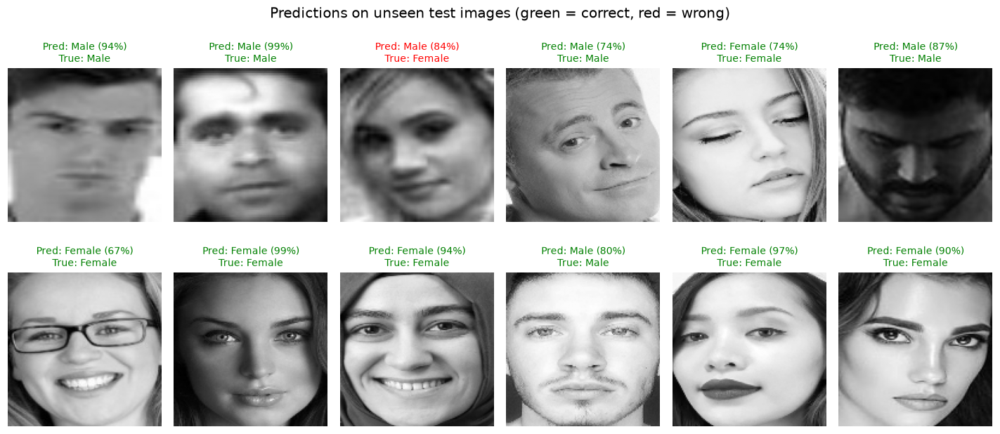
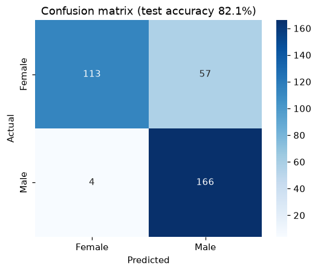
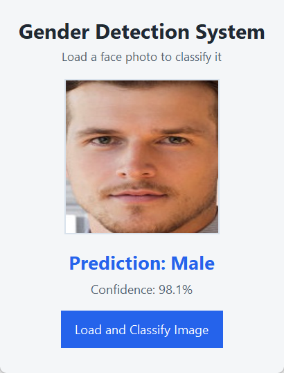
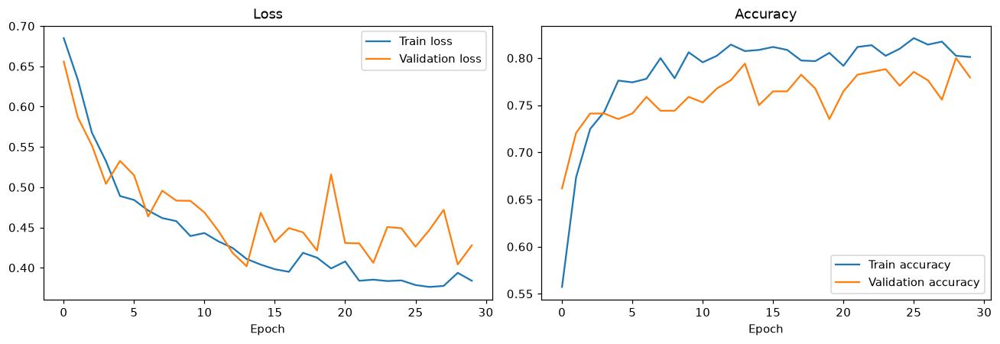
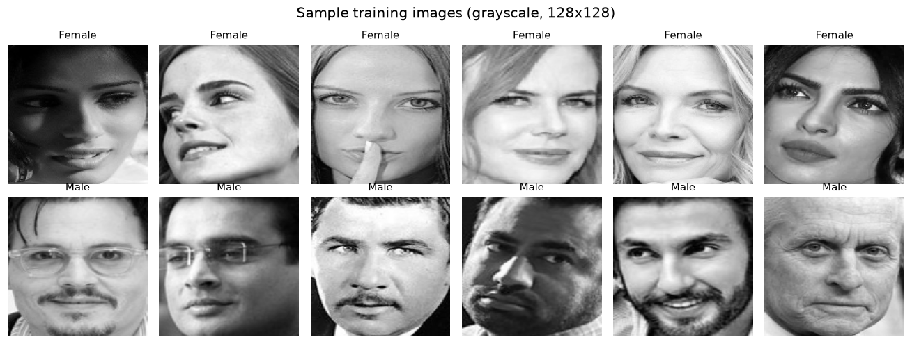

# Gender Detection System

A deep learning project that classifies face images as **Male** or **Female**. It uses TensorFlow/Keras, OpenCV and scikit-learn, and comes with a training notebook, a command-line predictor and a small desktop app.



## Results

Evaluated on a held-out test set of 340 images (170 per class) that the model never saw during training:

| Metric | Female | Male | Overall |
|--------|-------:|-----:|--------:|
| Precision | 0.966 | 0.744 | 0.855 |
| Recall | 0.665 | 0.976 | 0.821 |
| F1-score | 0.787 | 0.845 | 0.816 |
| **Accuracy** | | | **82.1%** |

<p>
  
  
</p>

The model is very good at recognising male faces (97.6% recall). It is more cautious with female faces: when it predicts *Female* it is right 96.6% of the time, but it labels about a third of female faces as male.

## How it works

1. **Load** the face images from `train/`, `valid/` and `test/` folders, each split into `men/` and `women/`.
2. **Preprocess:** convert to grayscale, resize to 128×128, flatten each image into a 16,384-value vector and L2-normalise it.
3. **Model:** a fully connected neural network.

   | Layer | Output | Parameters |
   |-------|--------|-----------:|
   | Dense (ReLU) | 64 | 1,048,640 |
   | Dropout 0.5 | 64 | 0 |
   | Dense (ReLU) | 128 | 8,320 |
   | Dropout 0.5 | 128 | 0 |
   | Dense (sigmoid) | 2 | 258 |

4. **Train** for 30 epochs with the Adam optimiser and binary cross-entropy loss, checking the validation set after each epoch.
5. **Evaluate** on the test set with accuracy, a classification report and a confusion matrix.



## Dataset

The dataset has 2,279 labelled face images: 1,599 for training, 340 for validation and 340 for testing, with an equal number of men and women in each split. The images are **not included** in this repository. See [data/README.md](data/README.md) for the source and the folder layout.



## Project structure

```
gender-detection-system/
├── gender_detection.ipynb   # Full pipeline: load, preprocess, train, evaluate, save
├── predict.py               # Command-line prediction for one or more images
├── app.py                   # Tkinter desktop app
├── src/
│   └── gender_detection.py  # Shared image loading, preprocessing and prediction code
├── model/
│   └── gender_model.keras   # Trained model
├── screenshots/             # Output images used in this README
├── data/README.md           # How to get and arrange the dataset
└── requirements.txt
```

## Getting started

```bash
git clone https://github.com/arslanahmedbhutto/gender-detection-system.git
cd gender-detection-system
pip install -r requirements.txt
```

A trained model is included, so you can make predictions right away:

```bash
python predict.py path/to/face.jpg
```

```
path/to/face.jpg: Male (98.1%)
```

Or open the desktop app and pick an image:

```bash
python app.py
```

To retrain the model, put the dataset in `data/dataset1/` (see [data/README.md](data/README.md)) and run `gender_detection.ipynb`.

## Tech stack

Python · TensorFlow / Keras · OpenCV · scikit-learn · NumPy · Matplotlib · Seaborn · Tkinter

## Possible improvements

- Replace the dense layers with convolutional layers (a CNN), which learn spatial features such as the eyes and jawline instead of individual pixels.
- Add face detection, for example with an OpenCV Haar cascade, so the app works on full photos and not only on cropped faces.
- Use data augmentation and class-threshold tuning to balance recall between the two classes.
